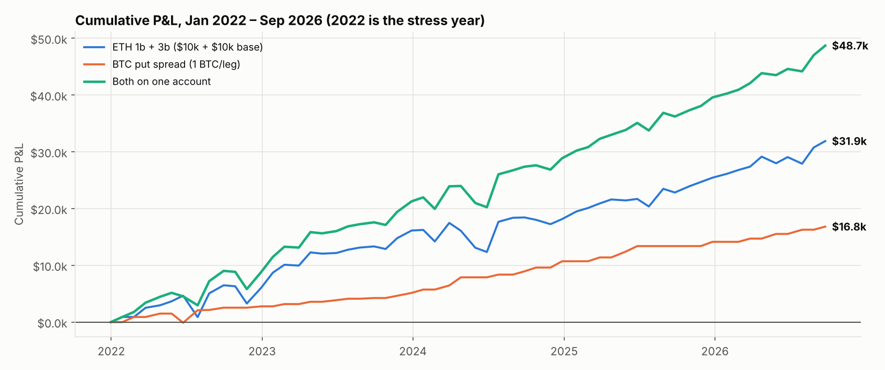
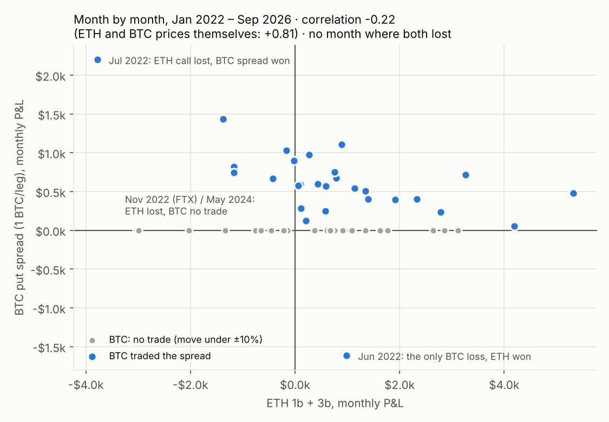
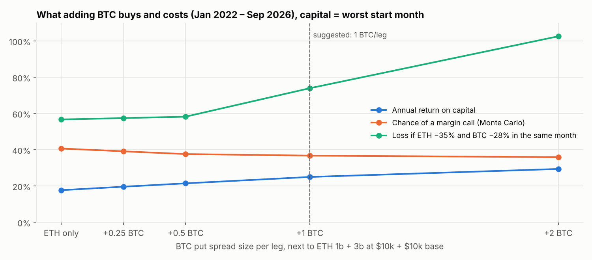

# ETH 1b + 3b combined with the BTC put spread: do they diversify?

**The two strategies, both on Deribit monthly expiries (last Friday, 08:00 UTC), on one USD account:**

* **ETH 1b + 3b (this repo):**
  * 1b: sell an ATM ETH put only after an up month.
  * 3b: after an up month sell an ATM put, after a down month an ATM call, each hedged with the perp beyond
    last month's low or high.
  * Full martingale per strategy, base $10k + $10k notional, Deribit margin checked hourly.
* **BTC put spread, the BTC session's recommended version:**
  * Source: [SellBTCPuts_3M](https://github.com/marcinzieba4-bot/SellBTCPuts_3M), branch `claude/vibrant-dijkstra-b4l7vt`,
    `put_spread.py`, variant C, 20% wing.
  * If BTC moved more than ±10% last month, sell the 10% OTM put and buy the 20% OTM put. Otherwise skip the month.
  * No hedge. Loss recovery (base + loss to recover ÷ net credit), capped at 4× the base.
  * The spread is fully secured: its collateral is its maximum loss.
  * I ran the BTC repo's own code to get it month by month (`btc/fetch_btc_spread.py`). It matches that session's
    results exactly: $3,801 fixed and $4,207 with recovery at 0.25 BTC, Jan 2022 – Nov 2026.

**Windows:**
* **Jan 2023 – Sep 2026** (45 months): the ETH study period.
* **Jan 2022 – Sep 2026** (57 months): adds 2022 (LUNA, 3AC, FTX) as a stress year. I extended the ETH data back to 2022 for this.

**Capital in this report** is the smallest balance that never hit margin **for the worst possible start month**.
I did not use the Jan-2023 start this time. BTC never lost in 2023–2026, so its early profits would make
any later start look cheaper than it is. On this basis, ETH 1b + 3b alone needs $27,267, not the $17,163
"lean" figure from PORTFOLIO.md.

---

## Summary: what the results mean for you

1. **Yes, they diversify each other, even though ETH and BTC prices move together.**
   * ETH and BTC monthly price moves are correlated **+0.81** (2022–26).
   * The two strategies' monthly P&L is correlated only **-0.02** (2023–26) and **-0.22** (2022–26).
   * There was **no month in which both lost**. BTC lost once in 57 months (Jun 2022), and that month ETH made money.
   * In ETH's 5 worst months, BTC either had no trade or made money (table below).
   * **Why:** they lose in different situations.
     * ETH loses when a month moves hard against the side it sold. Mostly that was a rally against 3b's calls (Jul 2022, May 2024),
       and once a crash against both ETH puts (FTX, Nov 2022, when BTC had no trade).
     * BTC trades only after a ±10% month and sells 10% below the price. It loses only if BTC falls more than 10% in the month after a big move.
2. **The combination is better on almost every historical measure. The worst single month stays about the same.**
   With **1 BTC per leg** next to ETH's $10k + $10k base (4× the BTC session's 0.25 BTC):

   | | ETH alone | ETH + BTC 1 BTC/leg |
   |---|---:|---:|
   | Capital needed | $27,267 | $25,832 |
   | Annual return, 2023–26 | 18.7% | **27.6%** |
   | Annual return, 2022–26 | 17.7% | **25.0%** |
   | Sharpe, 2023–26 / 2022–26 | 1.29 / 1.18 | **1.97 / 1.84** |
   | Max drawdown, month-end, 2022–26 | 11.8% | **9.2%** |
   | Max drawdown, intramonth, 2022–26 | 22.6% | **18.1%** |
   | Chance of a margin call (Monte Carlo), 2022–26 | 41% | **37%** |
   | Chance of ending with a loss (Monte Carlo), 2022–26 | 26% | **19%** |
   | Average result (Monte Carlo), 2022–26 | +68% | **+122%** |

   * BTC adds profit ($16,820 at 1 BTC/leg over 2022–26) without adding capital.
   * BTC's collateral peaks in months when ETH needs little, and its steady profits cushion ETH's bad months.
3. **The catch: one scenario hits all three positions at once, and it never happened in 2022–2026.**
   * After a strong **up** month, 1b sells a put, 3b sells a put, and BTC (after a green candle) sells its spread.
   * A crash in the following month would hit all three.
   * In the data, every BTC trade after a green candle won, and ETH puts after up months lost only moderately.
   * **Stress test:** apply ETH −35% and BTC −28% (the worst months of the period) to the positions actually held.
     * The worst month for this is **2024-12**. It would have cost ETH $10,214 plus BTC $8,893.
     * That is **74% of capital** at 1 BTC/leg, against 57% for ETH alone.
     * At 2 BTC/leg it is 103%, which wipes out the account.
   * **That is why I suggest 1 BTC per leg and not more.** In-sample, more BTC always looks better, because BTC
     almost never lost. That reflects the sample, not a real edge.
4. **What to do:**
   * Run both on one account: ETH 1b + 3b at your base, plus the BTC spread at about **5 BTC per leg
     for every $100k of ETH base notional** (that is 1 BTC per $10k + $10k).
   * Hold about **$25,832 per $10k + $10k ETH base + 1 BTC/leg**. That is about what ETH alone
     needs ($27,267).
   * Watch the months that follow a strong up month in both coins. ETH sells puts and BTC sells its spread at the same time,
     so that is where the joint-crash loss sits. A sensible extra rule (not backtested): in those months, if an ETH
     strategy is already above 2× its base, trade the BTC spread at its base size only, without recovery sizing.
   * The BTC spread's own risk is capped: max loss = (sold − bought strike − net credit) × size. Its collateral
     never needs topping up during the month.







---

## How strongly do they move together?

| | 2023–2026 | 2022–2026 |
|---|---:|---:|
| ETH vs BTC price, same month | +0.77 | +0.81 |
| **ETH strategy vs BTC strategy, monthly P&L** | **-0.02** | **-0.22** |
| Same, rank correlation | -0.01 | -0.08 |
| Same, only months when BTC traded | -0.36 | -0.49 |
| BTC trade months | 22 of 45 | 29 of 57 |
| ETH losing months / BTC losing months | 14 / 0 | 18 / 1 |
| **Months where both lost** | **0** | **0** |

ETH's five worst months, 2022–2026, and what BTC did:

| Month | ETH 1b + 3b | BTC spread, 1 BTC/leg |
|---|---:|---:|
| 2022-07 | -$3,780 | $2,202 |
| 2022-11 | -$3,037 | no trade |
| 2024-05 | -$2,994 | no trade |
| 2024-02 | -$2,031 | no trade |
| 2024-04 | -$1,378 | $1,435 |

---

## Full results

**Jan 2023 – Sep 2026** (the ETH study period):

| Setup | Capital needed | Total P&L | Annual return | Sharpe | Worst month | Max DD month-end / intramonth | Losing months | Chance of margin call | Chance of a loss | Joint-crash loss |
|---|---:|---:|---:|---:|---:|---:|---:|---:|---:|---:|
| **ETH 1b + 3b alone** | $27,267 | $24,527 | 18.7% | 1.29 | -11.0% | 13.7% / 27.1% | 14 | 33% | 23% | 44% (2024-06) |
| BTC spread alone, 0.25 BTC/leg | $2,507 | $3,512 | 26.3% | 2.81 | 0.0% | 0.0% / 12.8% | 0 | – | – | 100% (2025-06) |
| ETH + BTC 0.25 BTC/leg | $26,908 | $28,038 | 21.0% | 1.48 | -11.1% | 12.6% / 25.7% | 13 | 32% | 21% | 45% (2024-06) |
| BTC spread alone, 0.5 BTC/leg | $5,014 | $7,023 | 26.3% | 2.81 | 0.0% | 0.0% / 12.8% | 0 | – | – | 100% (2025-06) |
| ETH + BTC 0.5 BTC/leg | $26,549 | $31,550 | 23.2% | 1.65 | -11.3% | 11.4% / 24.4% | 13 | 31% | 19% | 49% (2024-12) |
| BTC spread alone, 1 BTC/leg | $10,027 | $14,046 | 26.3% | 2.81 | 0.0% | 0.0% / 12.8% | 0 | – | – | 100% (2025-06) |
| **ETH + BTC 1 BTC/leg** | $25,832 | $38,573 | 27.6% | 1.97 | -11.6% | 9.4% / 22.0% | 11 | 31% | 16% | 68% (2024-12) |
| BTC spread alone, 2 BTC/leg | $20,055 | $28,093 | 26.3% | 2.81 | 0.0% | 0.0% / 12.8% | 0 | – | – | 100% (2025-06) |
| ETH + BTC 2 BTC/leg | $27,286 | $52,619 | 33.2% | 2.47 | -11.0% | 8.1% / 18.9% | 9 | 28% | 11% | 97% (2024-12) |

**Jan 2022 – Sep 2026** (with 2022):

| Setup | Capital needed | Total P&L | Annual return | Sharpe | Worst month | Max DD month-end / intramonth | Losing months | Chance of margin call | Chance of a loss | Joint-crash loss |
|---|---:|---:|---:|---:|---:|---:|---:|---:|---:|---:|
| **ETH 1b + 3b alone** | $27,267 | $31,896 | 17.7% | 1.18 | -13.9% | 11.8% / 22.6% | 18 | 41% | 26% | 57% (2024-06) |
| BTC spread alone, 0.25 BTC/leg | $2,507 | $4,207 | 23.0% | 1.99 | -16.1% | 14.0% / 22.2% | 1 | – | – | 100% (2025-06) |
| ETH + BTC 0.25 BTC/leg | $26,908 | $36,103 | 19.6% | 1.36 | -12.0% | 10.4% / 21.2% | 16 | 39% | 24% | 57% (2024-06) |
| BTC spread alone, 0.5 BTC/leg | $5,014 | $8,413 | 23.0% | 1.99 | -16.1% | 14.0% / 22.2% | 1 | – | – | 100% (2025-06) |
| ETH + BTC 0.5 BTC/leg | $26,549 | $40,309 | 21.5% | 1.53 | -11.4% | 9.4% / 19.9% | 16 | 38% | 22% | 58% (2024-06) |
| BTC spread alone, 1 BTC/leg | $10,027 | $16,820 | 23.0% | 1.99 | -16.1% | 14.0% / 22.1% | 1 | – | – | 100% (2025-06) |
| **ETH + BTC 1 BTC/leg** | $25,832 | $48,716 | 25.0% | 1.84 | -11.8% | 9.2% / 18.1% | 15 | 37% | 19% | 74% (2024-12) |
| BTC spread alone, 2 BTC/leg | $20,055 | $33,640 | 23.0% | 1.99 | -16.1% | 14.0% / 22.1% | 1 | – | – | 100% (2025-06) |
| ETH + BTC 2 BTC/leg | $27,286 | $65,536 | 29.4% | 2.30 | -11.1% | 8.3% / 15.4% | 12 | 36% | 13% | 103% (2024-12) |

How to read the columns:

* **Capital needed**: the smallest starting balance that never hit Deribit maintenance margin (ETH, checked hourly)
  plus the BTC spread's max loss, for the worst start month. Annual return, Sharpe and drawdowns are on this capital.
* **Chance of margin call / of a loss**: a joint block bootstrap of the real months (3-month blocks, 4,000 paths). ETH and BTC
  are drawn from the same months, so their dependence is kept. Liquidation is modelled as in PORTFOLIO.md.
* **Joint-crash loss**: the worst month for the scenario ETH −35% and BTC −28% at the same time, applied to the positions held. ETH puts lose their worst
  historical loss per $; BTC spreads lose their full max loss. Months where ETH sold calls are not hit.
* **"BTC spread alone"** rows: the BTC strategy alone. Its capital is the largest spread collateral (Jun 2025, the widest
  wing), so a joint-crash loss of 100% means it loses exactly that collateral. A fully secured spread cannot lose more.
  It lost once (Jun 2022), so its Sharpe is high but rests on very few losses.

## BTC spread trades used (1 BTC per leg)

| Expiry | Last month's BTC move | Sold / bought strike | Net credit | Max loss | P&L |
|---|---:|---|---:|---:|---:|
| 2022-02 | -22.0% | 34,000 / 30,000 | $897 | $3,103 | $897 |
| 2022-04 | +14.2% | 40,000 / 35,000 | $1,035 | $3,965 | $599 |
| 2022-06 | -26.9% | 26,000 / 24,000 | $394 | $1,606 | -$1,613 |
| 2022-07 | -27.8% | 19,000 / 17,000 | $587 | $1,413 | $587 |
| 2022-08 | +14.6% | 22,000 / 19,000 | $633 | $2,367 | $51 |
| 2022-09 | -10.5% | 19,000 / 17,000 | $402 | $1,598 | $402 |
| 2022-12 | -18.1% | 15,000 / 14,000 | $236 | $764 | $236 |
| 2023-02 | +40.2% | 21,000 / 18,000 | $400 | $2,600 | $400 |
| 2023-04 | +16.3% | 25,000 / 22,000 | $402 | $2,598 | $402 |
| 2023-06 | -10.1% | 24,000 / 21,000 | $287 | $2,713 | $287 |
| 2023-07 | +16.0% | 28,000 / 25,000 | $252 | $2,748 | $252 |
| 2023-09 | -10.9% | 23,000 / 21,000 | $126 | $1,874 | $126 |
| 2023-11 | +25.0% | 31,000 / 27,000 | $397 | $3,603 | $397 |
| 2023-12 | +10.6% | 34,000 / 30,000 | $505 | $3,495 | $505 |
| 2024-01 | +12.7% | 38,000 / 34,000 | $590 | $3,410 | $590 |
| 2024-03 | +27.3% | 46,000 / 41,000 | $719 | $4,281 | $719 |
| 2024-04 | +37.1% | 63,000 / 56,000 | $1,435 | $5,565 | $1,435 |
| 2024-07 | -10.1% | 55,000 / 50,000 | $480 | $4,520 | $480 |
| 2024-09 | -11.4% | 53,000 / 48,000 | $576 | $4,424 | $576 |
| 2024-10 | +10.4% | 59,000 / 52,000 | $669 | $6,331 | $669 |
| 2024-12 | +41.8% | 86,000 / 76,000 | $1,107 | $8,893 | $1,107 |
| 2025-03 | -24.1% | 70,000 / 65,000 | $673 | $4,327 | $673 |
| 2025-05 | +10.2% | 84,000 / 75,000 | $1,030 | $7,970 | $1,030 |
| 2025-06 | +12.0% | 95,000 / 84,000 | $973 | $10,027 | $973 |
| 2025-12 | -16.9% | 82,000 / 75,000 | $750 | $6,250 | $750 |
| 2026-03 | -18.1% | 60,000 / 54,000 | $569 | $5,431 | $569 |
| 2026-05 | +13.4% | 70,000 / 62,000 | $820 | $7,180 | $820 |
| 2026-07 | -17.7% | 54,000 / 48,000 | $745 | $5,255 | $745 |
| 2026-09 | +24.7% | 72,000 / 64,000 | $545 | $7,455 | $545 |

## Re-running

```bash
# 1) the BTC side, from the BTC session's repo (only needed to refresh btc/*.csv)
git clone -b claude/vibrant-dijkstra-b4l7vt https://github.com/marcinzieba4-bot/SellBTCPuts_3M /path/to/btc
BTC_REPO=/path/to/btc python3 btc/fetch_btc_spread.py
# 2) the combination
python3 combo_report.py
```
