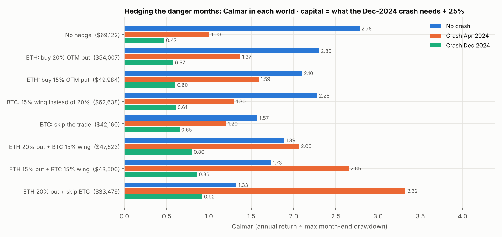

# Hedging the "danger months": can it stop Calmar falling to 0.47 in a crash?

**Setup.** This is the same portfolio and the same crash simulation as [SCENARIO.md](SCENARIO.md): ETH 1b + 3b
($10k + $10k base, martingale) plus the BTC put spread at 1 BTC/leg, Jan 2023 – Sep 2026. The crash is ETH −35%
and BTC −28% in the same month, right after a rally of both coins.

**Danger month:** ETH rose last month (so 1b and 3b both sell a put) **and** BTC had a big green candle (so the BTC
strategy sells its spread). All three positions are short the downside at once. That happened in
13 of 45 months, including the two crash months tested. **Every hedge below is used only in danger months.**

**Capital.** For each hedge it is what the account needs to survive the Dec 2024 crash, plus 25%. You prepare
for the worst case, so the same capital is used in all three worlds.

---

## Summary: what the results mean for you

1. **Yes, hedging the danger months works. Calmar in the Dec 2024 crash goes from 0.47 to 0.92.**
   The best version is **"buy a 20% OTM ETH put + skip the BTC trade"** in danger months:
   * The crash month costs $7,307 instead of $20,677.
   * The capital needed falls from $69,122 to **$33,479**.
   * The annual return on that capital rises from 12.6% to **17.9%**, in all three worlds.
   * Calmar in the Apr 2024 crash rises from 1.00 to 3.32.
2. **If you want to keep the BTC trade:** use **"buy a 15% OTM ETH put + narrow the BTC spread to a 15% wing"**.
   * Dec-crash Calmar 0.86 on $43,500, with 16.5% a year.
   * It keeps more profit in normal months ($33,615 vs $28,664), but needs more capital.
3. **Your hunch about BTC is right, and the reason is its recovery size, not just its loss.**
   * BTC's crash loss is $8,914. Its −28% candle then makes it open the next trade at the 4-BTC cap,
     which needs about $24k of collateral at the worst moment.
   * Skipping BTC in danger months alone lifts the Dec-crash Calmar to 0.65 and cuts the capital to $42,160.
   * A narrower 15% wing alone gives 0.61.
4. **The ETH tail put is cheap insurance.** A 20% OTM put costs about 1.2–1.4% of the ETH price, against about 6.6% collected on the ATM put.
   * Over the 13 danger months it cost $1,097 net in the real history.
   * In the Dec crash it pays back $4,456.
   * The 15% put protects more ($5,940) but costs more in normal months.
5. **Daily delta hedging does not work with the martingale.** Calmar falls to 0.29, and the capital needed is $152,997.
   * In normal up months the hedge loses about as much as the put earns, which turns winners into small losers.
   * The recovery rule then sizes up: 3b reached 43× base in mid-2024.
   * The BTC session found the same with its own recovery rule: the martingale must not be combined with hedges that realise small losses.
6. **The price of the hedge.**
   * With no crash, the hedged versions earn more per $ of capital (17.9% vs 12.6%), because they need less capital.
     But they swing more, so the no-crash Calmar is lower (1.33 vs 2.78).
   * You give up some of the smoothness of the good world to roughly halve the damage in the bad one.
   * The worst Calmar across the three worlds rises from 0.47 to 0.92.

### Rule to use

In a month where **ETH rose last month and BTC moved more than +10%**, at the monthly roll (last Friday, 08:00 UTC):
1. Sell the ETH puts as usual (1b and 3b, with their martingale sizes).
2. **Buy the ETH put nearest 0.80 × price**, same expiry, **1 for every ETH put sold** (the 1b and 3b sizes added together).
3. **Skip the BTC spread that month.** Or, to keep it: buy the 15% OTM BTC put instead of the 20% one, and buy the 0.85 × price ETH put instead.
4. Count the protective put's cost and payoff in the month's result for the martingale. That way, a crash that the put
   absorbed does not force a big recovery size afterwards.

---

## All variants (capital = what the Dec 2024 crash needs + 25%)

| Hedge in danger months | Capital held | Crash-month loss Dec 2024 (1b / 3b / BTC) | Annual return | Calmar: no crash | Calmar: crash Apr 2024 | **Calmar: crash Dec 2024** | Max DD, Dec crash | P&L, no crash |
|---|---:|---|---:|---:|---:|---:|---:|---:|
| No hedge | $69,122 | -$20,677 (-$5,773 / -$5,990 / -$8,914) | 12.6% | 2.78 | 1.00 | **0.47** | 24.8% | $38,573 |
| ETH: buy 20% OTM put | $54,007 | -$16,221 (-$4,041 / -$3,265 / -$8,914) | 15.1% | 2.30 | 1.37 | **0.57** | 24.3% | $37,476 |
| ETH: buy 15% OTM put | $49,984 | -$14,737 (-$3,521 / -$2,302 / -$8,914) | 15.9% | 2.10 | 1.59 | **0.60** | 24.5% | $36,944 |
| ETH: daily delta hedge | $152,997 | -$9,391 (-$176 / -$301 / -$8,914) | 5.2% | 0.32 | 0.21 | **0.29** | 16.0% | $31,823 |
| BTC: 15% wing instead of 20% | $62,638 | -$15,160 (-$5,773 / -$5,990 / -$3,397) | 12.6% | 2.28 | 1.30 | **0.61** | 20.4% | $35,243 |
| BTC: skip the trade | $42,160 | -$11,763 (-$5,773 / -$5,990 / $0) | 15.3% | 1.57 | 1.20 | **0.65** | 23.7% | $29,761 |
| ETH 20% put + BTC 15% wing | $47,523 | -$10,704 (-$4,041 / -$3,265 / -$3,397) | 15.5% | 1.89 | 2.06 | **0.80** | 19.1% | $34,147 |
| **ETH 15% put + BTC 15% wing** | $43,500 | -$9,221 (-$3,521 / -$2,302 / -$3,397) | 16.5% | 1.73 | 2.65 | **0.86** | 18.8% | $33,615 |
| **ETH 20% put + skip BTC** | $33,479 | -$7,307 (-$4,041 / -$3,265 / $0) | 17.9% | 1.33 | 3.32 | **0.92** | 19.6% | $28,664 |
| ETH delta hedge + BTC 15% wing | $155,153 | -$3,875 (-$176 / -$301 / -$3,397) | 4.6% | 0.28 | 0.21 | **0.27** | 16.3% | $28,494 |

* "Annual return" is on the capital held, with no crash. With the crash it is almost the same, because the martingale
  wins the loss back. The full numbers are in `results/hedge_summary.csv`.
* ETH tail puts use real Deribit prices of the 15% / 20% OTM put at each roll (`data/eth_otm_put_quotes.csv`).
  The one missing 20% quote (Jun 2025) is priced from the 15% put's implied vol.
* The BTC 15% wing uses the BTC session's own code and quotes (`btc/btc_spread_trades_w15.csv`).
* The delta hedge rebalances once a day at 08:00 UTC to the Black-Scholes delta (ATM implied vol moved by DVOL),
  pays 0.1% per perp fill and real funding.

## Limits

* This is one hand-built crash path and 13 danger months in 3¾ years, so treat the numbers as an estimate.
* The protective put helps most against a fast, deep crash like this one. In a slow −10% to −15% month it would expire
  worthless and the ETH puts would still lose.
* Skipping BTC in danger months gave up profit that BTC earned in every one of those months historically
  ($8,812 over 2023–26). That is the price of not stacking three short-downside positions.
