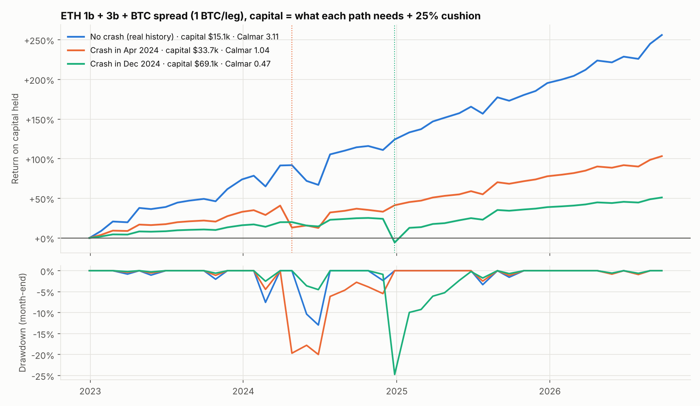

# What if ETH and BTC crash together right after a rally? (2024 simulation)

**Portfolio:** ETH 1b + 3b (full martingale, $10k + $10k base) plus the BTC put spread at 1 BTC per leg
(loss recovery, capped at 4 BTC). Everything is on one USD account, Jan 2023 – Sep 2026.

**How the crash is simulated (`scenario.py`):**

* Take the real history and replace one month with a crash of both coins:
  * **ETH** follows, hour by hour, its worst real month (31 Jan → 28 Feb 2025, **−35%**), including that month's
    implied-vol spike. The 3b hedge, margin and marks all see this path.
  * **BTC** follows its worst real month (27 May → 24 Jun 2022, **−28%**).
* Every later month is the real history, shifted down to the new lower prices. Later monthly moves, and so
  the strategies' up/down and big-candle signals, stay the real ones.
  * The month after the crash is the exception: it sees the crash as "last month". ETH 3b sells a call, and BTC
    sees a −28% candle and opens a spread, priced from the real Deribit quotes of that date.
* **Crash months tested.** Both come right after a rally of both coins, the setup where 1b, 3b and BTC are all short the downside:
  * **Apr 2024**, after the March 2024 all-time-high rally (ETH +21%, BTC +37%). Positions were at base size.
  * **Dec 2024**, after the November 2024 election rally (ETH +43%, BTC +42%). The ETH martingale was already
    at about 2× base. This is the worst case.
* **Capital:** what each path needs to never hit margin (Deribit margin checked hourly, from Jan 2023), **plus a 25% cushion**,
  as you described. So no scenario wipes out the account.
* **Calmar** = annual return on that capital ÷ max drawdown. It is shown with the month-end drawdown (the usual
  definition) and with the intramonth (hourly) drawdown.

---

## Summary: what the results mean for you

| | No crash (real history) | Crash in Apr 2024 | **Crash in Dec 2024** |
|---|---:|---:|---:|
| Capital needed (never hit margin) | $12,051 | $26,992 | **$55,297** |
| Capital held (+25% cushion) | $15,064 | $33,739 | **$69,122** |
| Crash month: 1b / 3b / BTC | – | -$2,753 / -$1,016 / -$5,580 | -$5,773 / -$5,990 / -$8,914 |
| Crash month total | – | -$9,350 | **-$20,677** |
| Worst month, % of capital | -19.9% | -27.7% | -29.9% |
| Total P&L, Jan 2023 – Sep 2026 | $38,573 | $34,825 | $35,311 |
| Annual return on capital held | 40.3% | 20.8% | **11.6%** |
| Max drawdown, month-end | 13.0% | 20.0% | **24.8%** |
| Max drawdown, intramonth | 30.2% | 34.6% | 26.0% |
| **Calmar (month-end drawdown)** | **3.11** | **1.04** | **0.47** |
| Calmar (intramonth drawdown) | 1.33 | 0.60 | 0.45 |
| Sharpe | 1.97 | 1.21 | 0.65 |
| Months to a new equity high after the crash | – | 8 | 8 |
| Largest size 1b / 3b / BTC | 2.1× / 7.9× / 1.0 BTC | 7.1× / 7.5× / 4.0 BTC | 10.3× / 8.6× / 4.0 BTC |

Each path is measured on its own capital. The no-crash path holds much less capital, so its intramonth swings look
larger in %, even though they are smaller in dollars.

1. **The Dec 2024 crash costs $20,677 in one month, and the account survives it.**
   * That is 29.9% of the capital held. The deepest drawdown is 24.8%.
   * **Calmar falls from 3.11 to 0.47** (month-end drawdown), and the annual return on capital
     from 40.3% to 11.6%.
   * The milder Apr 2024 version gives Calmar 1.04 and 20.8% a year.
2. **The martingale wins the money back.** Total profit ends only a little lower ($35,311 vs $38,573).
   * Equity is back at a new high 8 months after the crash.
   * For ETH alone the final profit is identical to the cent. The recovery sizing pays back exactly what was lost.
   * BTC ends a little lower, because its profits after the crash are earned at a 27% lower BTC price.
3. **The crash itself is not what needs the capital. The recovery after it is.**
   * The account needs **$55,297**, not $12,051, although the crash month loses only $20,677.
   * The peak need comes in **Jan 2025, the month after the crash**:
     * BTC sees the −28% candle and opens its recovery spread at the 4-BTC cap (about $24,030 of collateral).
     * 3b sells its recovery call at 8.6× base.
     * All of that comes on top of the loss just taken.
   * 1b carries its loss through 5 skipped months (Jan–May 2025, after four down months in a row) and comes back
     at **10× base** in Jun 2025.
4. **Capping the martingale does not raise Calmar** (table below).
   * Tighter caps need less capital but also earn less, and they lengthen the recovery. Calmar stays around 0.4–0.5 in the Dec case.
   * Your current setup (ETH uncapped, BTC capped at 4×) is about as good as any cap tested.
5. **The price of being ready.**
   * If you hold the Dec-crash capital ($69,122) and the crash never comes, the real history gives
     **12.6% a year with a 4.5% max drawdown** (Calmar 2.78).
   * So the insurance costs most of the return in a normal world.
   * A middle way, about **$34,000–$55,000 per $10k + $10k ETH base + 1 BTC/leg**, covers an
     Apr-2024-type crash fully. A Dec-type crash would then still need a top-up from outside the exchange.
6. **For comparison, ETH alone in the Dec 2024 crash** (no BTC):
   * Needs $33,824 (+25% = $42,280).
   * Loses $11,763 in the crash month.
   * Earns 13.0% a year with Calmar 0.53.
   * The BTC spread adds about $8,914 to the crash loss and ~$21,473 to the capital needed, and keeps its
     extra return. On a risk-adjusted basis the combination stays a little behind ETH alone in this one scenario (Calmar 0.47 vs 0.53).

---

## Month by month around the Dec 2024 crash

Equity uses the capital held ($69,122). The ETH and BTC columns are each coin's move that month in the scenario.

| Month | ETH | BTC | 1b | 3b | BTC spread | Month P&L | Equity |
|---|---:|---:|---|---|---|---:|---:|
| 2024-11 | +43% | +42% | – | CALL 1.2×: -$760 | – | -$760 | $85,842 |
| 2024-12 **crash** | -35% | -28% | PUT 2.1×: -$5,773 | PUT 2.4×: -$5,990 | 1.00 BTC: -$8,914 | -$20,677 | $65,165 |
| 2025-01 | -2% | +10% | – | CALL 8.6×: $7,813 | 4.00 BTC: $5,007 | $12,820 | $77,986 |
| 2025-02 | -35% | -24% | – | CALL 1.0×: $609 | – | $609 | $78,595 |
| 2025-03 | -9% | +8% | – | CALL 1.0×: $791 | 4.00 BTC: $1,954 | $2,745 | $81,340 |
| 2025-04 | -7% | +10% | – | CALL 1.0×: $707 | – | $707 | $82,047 |
| 2025-05 | +48% | +12% | – | CALL 1.0×: -$169 | 3.62 BTC: $2,706 | $2,537 | $84,584 |
| 2025-06 | -7% | +2% | PUT 10.3×: $1,013 | PUT 1.2×: $122 | 1.00 BTC: $706 | $1,841 | $86,425 |
| 2025-07 | +48% | +8% | – | CALL 1.1×: -$1,332 | – | -$1,332 | $85,093 |
| 2025-08 | +21% | -5% | PUT 8.1×: $6,281 | PUT 2.8×: $2,156 | – | $8,437 | $93,530 |
| 2025-09 | -11% | -1% | PUT 1.0×: -$325 | PUT 1.0×: -$325 | – | -$650 | $92,880 |

## Does capping the martingale help? (Dec 2024 crash)

| ETH size cap | BTC size cap | Capital needed | Total P&L | Annual return | Max DD month-end | Calmar month-end | Calmar intramonth |
|---|---|---:|---:|---:|---:|---:|---:|
| none | 4× | $55,297 | $35,311 | 11.6% | 24.8% | 0.47 | 0.45 |
| 6 | 4× | $47,641 | $32,956 | 12.5% | 28.1% | 0.44 | 0.44 |
| 4 | 4× | $41,500 | $30,889 | 13.3% | 31.3% | 0.42 | 0.42 |
| none | 2× | $45,485 | $32,878 | 12.9% | 28.8% | 0.45 | 0.38 |
| none | 1× | $40,693 | $28,131 | 12.5% | 31.4% | 0.40 | 0.32 |
| 4 | 1× | $23,513 | $23,709 | 17.1% | 46.6% | 0.37 | 0.34 |

## Limits

* This is one hand-built path, not a forecast. A real crash could be longer, for example two down months in a row after
  the rally, or it could hit when the martingale is already deeper. Either would need more capital than shown here.
* Implied vol after the crash month is the real one of each later month. After a real crash it would be higher,
  which means richer premiums for the recovery trades (slightly better for the strategy) but also higher margin.
* BTC spreads in the scenario are marked at intrinsic value during the month. Their margin is their max loss
  either way, so this only affects the intramonth drawdown a little.
